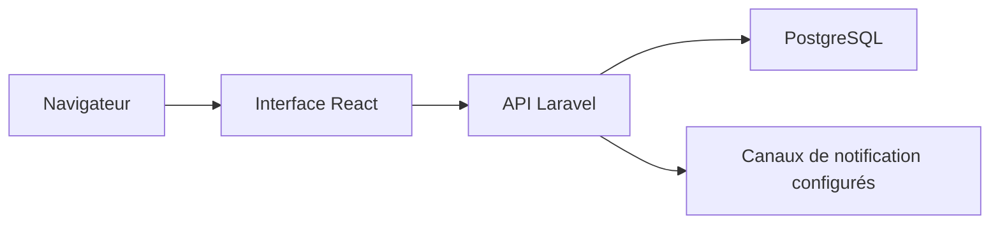

# Carnet Scolaire — documentation du projet

Application de gestion scolaire pour les établissements, leurs équipes et les familles. Elle comprend un site public, des espaces selon les profils et une administration propriétaire de la plateforme.

## Architecture

| Partie | Technologies et rôle |
| --- | --- |
| `frontend/` | React 19, React Router 7, Vite 8 : interface et appels API |
| `backend/` | Laravel 13, Sanctum, Spatie Permission : authentification, permissions et règles métier |
| Données | PostgreSQL ; base Docker locale ou Neon en production |
| Tests | Vitest et Testing Library pour l’interface ; PHPUnit pour l’API |
| Docker | Node 22 pour compiler React, Nginx pour le servir ; PHP 8.5 et Apache pour l’API |



Le frontend transmet un jeton d’authentification et l’en-tête `X-School`, qui identifie l’école. Les autorisations et l’isolation des établissements sont contrôlées côté serveur. Masquer un bouton ne remplace pas une autorisation API.

## Profils et fonctionnalités

| Espace | Utilisation principale |
| --- | --- |
| Site public | Présentation, actualités, formations, contact, demande de démonstration |
| Administration | Années, classes, matières, utilisateurs, rôles, paramètres, journal |
| Direction | Effectifs, absences, retards, impayés, lectures confirmées et outils autorisés |
| Secrétariat | Inscriptions, réinscriptions et gestion administrative selon les permissions |
| Enseignant | Notes, évaluations, devoirs, observations et échanges |
| Parent | Enfants rattachés, suivi, messages et activation du compte élève |
| Élève | Dossier personnel et outils pédagogiques autorisés |
| Comptabilité | Règlements, échéances et reçus selon les droits attribués |
| Surveillance et personnel | Présences, discipline et fonctionnalités attribuées |
| Propriétaire | Établissements, demandes, services, abonnements, paiements et sécurité du compte |

Les permissions déterminent les fonctionnalités réellement accessibles. Le code d’école fait partie du contexte de connexion. Le propriétaire possède un parcours d’authentification et de double authentification distinct.

## Parcours d’un établissement

1. Préparer l’identité de l’école, l’année scolaire, les classes et les matières.
2. Créer ou inviter les membres de l’équipe et attribuer leurs permissions.
3. Rechercher les dossiers existants avant une nouvelle inscription.
4. Renseigner l’élève, son responsable, les matricules, la scolarité et les frais.
5. Vérifier le récapitulatif avant de confirmer.
6. Utiliser les présences, devoirs, notes, bulletins et messages.
7. Enregistrer les règlements et suivre les échéances avec les comptes autorisés.

La réinscription retrouve le dossier existant et conserve le matricule. Les validations finales sont effectuées par l’API.

## Environnements et branches

| Environnement | Branche | Interface | API | Base |
| --- | --- | --- | --- | --- |
| Production | `Amina` | Cloudflare Pages | Render | Neon |
| Tests locaux | `codex/tests-docker` | `http://localhost:8080` | `http://localhost:8081/api` | Service Docker `db` |

La configuration Docker locale reste sur la branche de test. Les changements applicatifs validés peuvent être transférés séparément vers `Amina`, après revue. Les conteneurs locaux s’arrêtent avec l’ordinateur ; les services hébergés fonctionnent indépendamment de celui-ci, selon leurs offres d’hébergement.

## Installation locale avec Docker

Prérequis : Git, Docker Desktop démarré avec le moteur Linux et PowerShell. Depuis la racine du dépôt :

```powershell
git switch codex/tests-docker
.\start-docker.ps1
```

Le script crée `.env.docker` avec des secrets aléatoires s’il n’existe pas, construit les services séparément, démarre PostgreSQL, l’API et le frontend, attend les contrôles de santé et initialise l’école fictive `demo-docker`.

Ouvrir `http://localhost:8080/connexion?school=demo-docker`. Les identifiants comprennent `admin.demo`, `director.demo`, `secretary.demo`, `teacher.demo` et `parent.demo`. Le mot de passe créé est enregistré dans `.env.docker-demo`, jamais dans cette documentation.

L’interface et l’API sont publiées uniquement sur `127.0.0.1`. PostgreSQL ne possède pas de port publié sur l’ordinateur. Les emails utilisent le transport `array`, SMS et WhatsApp sont désactivés, et les abonnements ne bloquent pas les tests locaux.

Si `docker` n’est pas reconnu, rouvrir le terminal ou utiliser le chemin de `docker.exe` détecté dans `start-docker.ps1`.

```powershell
# État des services
docker compose --env-file .env.docker -f compose.local.yaml ps

# Journaux de l’API
docker compose --env-file .env.docker -f compose.local.yaml logs --tail 100 backend

# Arrêt sans effacer les données
docker compose --env-file .env.docker -f compose.local.yaml stop

# Redémarrage des conteneurs existants
docker compose --env-file .env.docker -f compose.local.yaml start
```

Les volumes `postgres_data` et `backend_storage` conservent les données. Ne pas utiliser `down -v` pour un arrêt normal : il supprime les volumes. Ne pas modifier le mot de passe de `.env.docker` sans mettre à jour la base déjà initialisée.

## Modifier et tester l’interface

Le frontend Docker est compilé. Après modification :

```powershell
docker compose --env-file .env.docker -f compose.local.yaml build frontend
docker compose --env-file .env.docker -f compose.local.yaml up -d --no-deps frontend
```

Actualiser avec `Ctrl + F5`. Pour le backend, reconstruire puis recréer le service `backend` ; les migrations sont exécutées par son script de démarrage.

Pour utiliser Vite hors Docker : dans `frontend/`, exécuter `npm ci`, copier `.env.example` en `.env`, définir `VITE_API_URL` vers l’API locale et lancer `npm run dev`. Les origines locales du port Vite habituel `5173` figurent dans la configuration CORS.

## Variables de configuration

| Variable | Fonction |
| --- | --- |
| `APP_KEY` | Clé Laravel à conserver entre les déploiements |
| `APP_ENV`, `APP_DEBUG` | En production : `production` et `false` |
| `APP_URL` | URL publique du backend |
| `FRONTEND_URL` | Origine exacte du frontend autorisée par CORS |
| `DB_CONNECTION`, `DB_URL` | Pilote `pgsql` et connexion PostgreSQL |
| `DB_SSLMODE` | Mode SSL PostgreSQL ; utiliser `require` avec Neon |
| `TENANCY_DEFAULT_SCHOOL` | École utilisée par défaut |
| `SETUP_ENABLED`, `DEMO_ENABLED` | Activation des parcours de configuration et commandes de démonstration |
| `SUBSCRIPTIONS_ENABLED` | Application des règles d’abonnement |
| `VITE_API_URL` | URL de l’API incluse dans la compilation du frontend |
| `VITE_SCHOOL_SLUG` | Code d’école par défaut inclus dans le frontend |

Les variables `VITE_*` sont publiques dans le navigateur. Ne jamais y placer une clé Laravel, un mot de passe PostgreSQL ou une clé de paiement. Les fichiers `.env*`, archives et clés privées sont exclus de Git. `.gitignore` ne retire pas un secret déjà présent dans l’historique : révoquer tout secret exposé. Un collaborateur doit recevoir ses propres accès aux services nécessaires.

## Déploiement

### Frontend : Cloudflare Pages

- Branche de production : `Amina`, à vérifier dans les réglages du service.
- Répertoire racine : `frontend`.
- Commande de compilation : `npm run build`.
- Répertoire de sortie : `dist`.
- `VITE_API_URL` : URL HTTPS du backend suivie de `/api`.

Une modification de variable `VITE_*` exige une nouvelle compilation. Les branches de test peuvent déclencher des prévisualisations si cette option est activée ; ne pas leur fournir des accès de production.

### Backend : Render ; base : Neon

Utiliser `backend/Dockerfile` et `backend/scripts/render-start.sh`, avec les chemins adaptés au répertoire racine configuré dans Render. Le script vérifie les variables, configure le port Apache, met la configuration en cache et exécute `php artisan migrate --force` avant le démarrage.

Configurer les secrets dans Render, notamment `APP_KEY` et `DB_URL`. Utiliser la connexion PostgreSQL Neon avec SSL. Les migrations créent ou modifient la structure ; elles ne transfèrent pas les données d’une ancienne base. Prévoir une sauvegarde et un transfert distinct avant de désactiver une ancienne base.

Après publication : vérifier l’interface, `/up` du backend, la connexion avec le code d’école, CORS et plusieurs parcours métier. `/up` seul ne valide pas toutes les permissions, les paiements ou les notifications.

## Tests et qualité

Dans `frontend/` :

```powershell
npm ci
npm test -- --maxWorkers=1
npm run build
npm run lint
```

Pour des tests frontend avec les dépendances isolées dans Docker, depuis la racine :

```powershell
docker build --target build -t carnet-v2-frontend-tests ./frontend
docker run --rm --network none carnet-v2-frontend-tests npm test -- --maxWorkers=1
```

Pour le backend, dans un environnement de test distinct de la production :

```powershell
cd backend
composer install
php artisan test
```

Vérifier la configuration et la base de test avant exécution. L’image backend utilise `--no-dev` et ne contient pas PHPUnit. Compléter les tests automatisés par des essais des permissions, de l’isolation entre écoles et de l’affichage sur téléphone.

## Exploitation et sauvegardes

Les tâches figurant dans `backend/routes/console.php` nécessitent un ordonnanceur Laravel réellement configuré sur l’hébergement. Selon le pilote choisi, un worker de file d’attente est également nécessaire. Le code seul ne garantit pas leur exécution.

Les tâches incluent le contrôle des services, un heartbeat de file d’attente, les rappels d’abonnement et les sauvegardes. Les rappels et sauvegardes dépendent de leurs options de configuration. Les sauvegardes utilisent notamment `BACKUPS_ENABLED` et une clé de chiffrement à conserver séparément des archives.

Prévoir un stockage persistant, des copies externes et un essai de restauration. Les fichiers du stockage temporaire d’un hébergeur peuvent disparaître au redéploiement. Ne jamais tester une restauration en écrasant la production.

## Paiements et abonnements

Les paiements scolaires sont distincts des paiements d’abonnement à la plateforme. Le propriétaire peut enregistrer le paiement d’un établissement : formule, durée de 1 ou 12 mois, montant, moyen de paiement et référence. La confirmation enregistre le paiement et calcule l’échéance ; le backend contrôle les doublons de référence.

Vérifier la réception réelle de l’argent avant une confirmation manuelle. Un prestataire de paiement ou de notification exige sa propre configuration ; la présence d’un écran ne garantit pas son activation.

Voir aussi : [paiements multicanaux](backend/docs/PAIEMENTS_MULTICANAUX.md).

## Dépannage

| Symptôme | À vérifier |
| --- | --- |
| `docker` non reconnu | Installation, nouveau terminal, chemin de l’exécutable |
| Compilation interrompue | Mémoire disponible, moteur Docker ; construire les services séparément |
| Connexion locale refusée | URL `localhost:8080`, code `demo-docker`, accès locaux |
| Erreur CORS | Origine exacte : protocole, hôte et port dans `FRONTEND_URL` |
| Modifications invisibles | Reconstruction Docker ou nouveau déploiement, puis actualisation |
| API indisponible | Journaux, `APP_KEY`, connexion PostgreSQL et migrations |
| Notifications absentes | Transport, prestataire, worker et tâches planifiées |

## Validation avant usage réel

Préparer les améliorations sur la branche de test avant de les publier. Les tests ne constituent pas une certification de sécurité ni une vérification exhaustive de tous les parcours. Contrôler les données initiales, les permissions, la restauration, les services externes, les documents imprimés et l’ergonomie sur les appareils utilisés par l’école.
